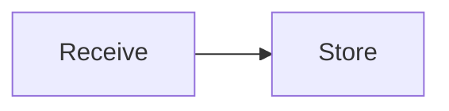

# LiveNote vault implementation contract

Status: ready for implementation. This document is the shared server/UI contract, not a request for another design pass.

## Scope and decisions

Implement the approved nested filesystem Markdown vault and document-oriented UI. Files are authoritative. Keep existing REST/MCP block tools, diagram validation, visual Mermaid/BPMN/draw.io editors, and transparent PNG export. Add page links, backlinks, tags, text search, a sidebar tree, document tabs, navigation history, and a properties panel.

Do not add collaboration/CRDTs, automatic Git operations, a graph view, plugins, arbitrary attachments, a second document database, or a rich-text editor. Navigation history means back/forward between pages, not stored content versions. Git remains an external user workflow.

The important trade-off: in vault mode `revision: number` becomes an opaque content fingerprint, not an incrementing counter. It includes referenced XML bytes. This makes stale block-client writes fail after external edits and after deleting/rebuilding the index, without rewriting YAML on reads. Keep incrementing revisions in explicit legacy SQLite mode. The existing API contract tells clients to send the revision they observed; it does not authorize calculating the next revision. Remove the current UI's numeric less-than comparisons. Full-document writes additionally require a full SHA-256 `expectedVersion`.

The other important decision: the existing `parseMarkdownToBlocks` and `exportPageMarkdown` remain interchange helpers. They must never be the vault document save path: the importer removes the first title and trims text, and the exporter rebuilds sections and whitespace.

## Current-code anchors checked

- `src/shared/types.ts`: `Block`, `PageSummary`, `PageFull`, `WriteBlockResult`, `LiveEvent`, `ApiConfig`, `AppConfig`, `UpdatePagePatch`; page revisions are numbers, block source excludes diagram fences.
- `src/server/db.ts`: `NoteStore` is a synchronous concrete class; creates UUID page IDs; stores stable per-page block IDs; supports soft deletion, render confirmations and request receipts. Writes currently increment revisions even for identical block source despite the comment.
- `src/server/services.ts`: one `NoteService` serves both transports; validates diagrams before writes; BPMN preserve/auto semantics must remain; validators await, so freshness must be checked again at commit.
- `src/server/app.ts`: directly constructs `NoteStore(config.dbPath)` and returns it in `RunningApp`; tests call `running.store.close()`.
- `src/server/index.ts`: only SQLite CLI/config exists; default currently resolves `~/.livenote/livenote.sqlite`.
- `src/server/rest.ts`: page GET/POST/PATCH and block writes return `{page}`; block writes optionally add `validation`; page DELETE is 204. Import returns a `PageFull` directly.
- `src/server/mcp/mcpEndpoint.ts`: retain tool names, snake_case inputs, result shapes, and textual `isError` mapping with `details.currentRevision`.
- `src/web/api.ts`: `createBlock` is currently typed as `WriteBlockResult` although REST returns `{page, validation}`. Fix this wrapper in the frontend work while preserving the server response.
- `src/web/App.tsx`: existing tabs, follow behavior and SSE; numeric revision ordering is not valid for vault fingerprints.
- `src/web/components/PageView.tsx`: current read/edit is block-based and conflict handling refreshes; new document drafts must not be replaced by these refreshes.
- `tests/drawio-api.test.ts`: passes only `dbPath` to `createApp`, asserts `revision + 1`, closes the returned store. Preserve this test's SQLite behavior.
- `tests/visual-editor.test.mjs` and `tests/drawio-editor.test.mjs`: require `LIVENOTE_TEST_URL`, start Chrome, create isolated pages and delete them afterward.
- Root/server/web `AGENTS.md`, `DESIGN.md`, local HeroUI quick-start, Tabs and TextField docs were read. The requested `codebase-design` skill was not exposed in the supplied skill roots or skill tools; no requirements from an unread skill are assumed.

## Storage and document grammar

Example vault (all paths below are relative to the configured root):

```text
Projects/Storage.md
Projects/Operations/Receiving.md
_assets/<page-id>/warehouse.bpmn
_assets/<page-id>/architecture.drawio
.livenote/cache/                 # disposable, never authoritative
.livenote/transactions/          # only unfinished write/recovery records
.livenote/requests/              # durable 24-hour idempotency receipts
.livenote/trash/<transaction-id>/ # soft-deleted files, not indexed
.livenote/lock                   # single LiveNote writer for this vault
```

Do not auto-run `git init` or modify a user's `.gitignore`. Document that `_assets` and Markdown belong in Git; `.livenote` is operational state and should be ignored. Deleting only `.livenote/cache` must not lose notes, IDs, links, freshness guarantees or request receipts. Begin with an in-memory derived index; a persisted index is unnecessary for this increment.

Markdown files are UTF-8. API-created files use LF, but parsing and span edits preserve existing LF/CRLF, YAML formatting, unknown YAML properties, comments, blank lines, headings, ordinary code fences and final-newline presence. Reject non-UTF-8 input instead of lossy decoding. Nested directories are real folders.

````markdown
---
id: 6ff920e3-aabd-45fe-bf28-d63bb76207ba
title: Storage
aliases:
  - Warehouse
tags:
  - operations
created: "2026-11-16T18:00:00.000Z"
updated: "2026-11-16T18:00:00.000Z"
---
<!-- livenote:block {"id":"intro","type":"markdown"} -->
# Storage

See [[6ff920e3-aabd-45fe-bf28-d63bb76207bb|Receiving]].

<!-- livenote:block {"id":"main-flow","type":"mermaid","title":"Receipt flow"} -->


<!-- livenote:block {"id":"warehouse","type":"bpmn","title":"Warehouse process"} -->

````

Rules:

1. YAML frontmatter must be the initial `---` document. `id` is required for an indexed page and follows existing `ID_PATTERN` (existing UUIDs pass). IDs are case-sensitive and never derive from path/title. `title` is optional: use the filename stem when absent. Generated files include a title. `aliases` and `tags` default to `[]`; both must be arrays of nonempty strings. Preserve order/spelling; deduplicate exact duplicates on API metadata edits. `created`/`updated` are optional ISO dates. Unknown YAML keys remain untouched. Do not allow YAML object construction/custom tags or duplicate keys.
2. Only top-level standalone `<!-- livenote:block {...} -->` lines outside fenced code are structural. JSON contains required `id`, `type` and optional `title`; unknown fields survive unrelated edits. Optional `createdAt`/`updatedAt` ISO fields are allowed for migrated block timestamps. Optional `framingNewline: true` is allowed only on Markdown markers: it records one generated separator line ending, matching that marker line's LF/CRLF, excluded from the end of projected `Block.source`. This preserves exact source when a block without a final newline must precede another standalone marker, including migration, append and reorder operations. Missing/mismatched separator bytes are an invalid block. Duplicate IDs or malformed structural markers are document problems, never silently repaired.
3. A marked Markdown block is the exact bytes after its marker newline up to the next structural marker/EOF, excluding only the explicit separator described by `framingNewline: true`. For a marked Mermaid block, allow exactly one fenced `mermaid` code block plus whitespace; `Block.source` is its content, excluding the one line ending immediately before the closing fence. Support backtick or tilde fences of length at least three, paired correctly; do not recognize markers inside ordinary fenced code. `title` belongs to marker metadata, not the SVG.
4. Marked BPMN/draw.io blocks contain exactly one Markdown image reference plus whitespace. Its destination is relative to the note directory, resolves under `_assets/<this-page-id>/`, and ends in `.bpmn` or `.drawio` respectively. Generated paths are `_assets/<page-id>/<block-id>.<extension>`; the Markdown destination is made relative to the note directory. `Block.source` is the exact decoded XML file text. Titles come from marker metadata; image alt is human-readable fallback. Do not inline XML into the vault Markdown.
5. Unmarked ordinary Markdown is allowed. Parse its body into Markdown runs and top-level Mermaid fences using source ranges, not the old importer. A plain BPMN/draw.io image is ordinary Markdown unless explicitly marked. Assign an unmarked segment's projection ID as `auto-` plus the first 16 hex digits of SHA-256 of `type + NUL + exact segment bytes + NUL + zero-based occurrence among identical segments`. On the first API operation that changes or reorders that segment, insert a marker with that observed ID; preserve other bytes. Whole-document saves insert IDs for new/changed unmarked segments before returning canonical saved source; a byte-identical save inserts nothing. Existing marked IDs must survive ordinary edits. Deleting a marker deliberately removes that identity; the replacement segment gets a new ID. These transient unmarked IDs are not a promise of identity across arbitrary external edits.
6. Files without YAML IDs remain untouched and appear as `missing_id` diagnostics, not silently adopted notes. The UI explains that adding `id` in frontmatter makes an external note available. No new adoption subsystem is needed. Duplicate page IDs quarantine every file sharing that ID; never choose a winner.
7. Diagram source is not normalized when loading or saving unchanged content. API source changes reuse the established validators; new/changed XML must parse before any publication. Whole-document BPMN saves preserve XML; autorender/layout remains the explicit existing layout operation. Renderer unavailability retains the current `not_checked/unavailable` behavior. Do not revalidate unchanged diagrams merely to save prose.
8. `PageFull.blocks` is a projection of these source spans and loaded assets, not a second stored representation. Markdown rendered in read mode omits structural comments. Render confirmations remain ephemeral cache/runtime state and never edit Markdown/XML or revision.

## Configuration, defaults and migration

Extend `AppConfig` with `vaultPath?: string`. Retain required `dbPath` for source compatibility with current tests/callers. `createApp(config)` selects vault storage when `vaultPath` is defined; with only `dbPath` it keeps SQLite. This deliberate factory compatibility is separate from the CLI default.

CLI serving selection, in order:

- `--vault <path>` selects a vault and overrides both storage environment variables.
- `--db <path>` explicitly selects legacy SQLite and overrides both storage environment variables.
- Both flags during serve are a usage error. With no storage flag, use exactly one nonempty `LIVENOTE_VAULT` or `LIVENOTE_DB`; both set is a usage error.
- With neither flag nor storage env, select `~/.livenote/vault`. Resolve user paths against cwd; reject empty values. Create the directory only on explicit startup, never while inspecting config.
- If the old default database exists, print its location and the explicit migration command once at startup. Never auto-import, delete, rename, modify or hide it behind an automatic migration.
- Preserve port, token, Host/Origin checks, theme and `--open` behavior.

Add `livenote migrate --db <sqlite-path> --vault <new-vault-path>` (no server starts). Both arguments are required, no implicit default source/destination. The destination must be absent or empty. Open SQLite read-only; do not construct the current mutating `NoteStore` merely to read a migration source. Use a consistent read transaction/snapshot so WAL data is included; do not copy a live `.sqlite` file without its WAL.

Migration stages a sibling destination directory, verifies all generated notes/assets by reparsing, then renames the staging directory to the destination. Any failure leaves the source unchanged and cleans the staging directory. Preserve page IDs, block IDs, types, order, source, diagram titles, and page/block timestamps. Preserve deleted pages under `.livenote/trash/migration/`, not the active list. Name migrated active files `<safe-title>--<page-id>.md` at the root; avoid title collisions by ID suffix. Persist optional marker timestamps for migrated blocks. Do not use export/import helpers. Historical numeric revisions cannot be preserved while adding external-edit fingerprints; migration reports that clients must reread their pages. It does not migrate ephemeral render status or old request receipts. Rerunning into a nonempty target refuses; no overwrite/merge mode.

Factory shutdown must keep `running.store.close()` usable for existing tests. Add `running.close(): Promise<void>` for new integration tests/CLI shutdown: close watchers/timers, validators, store and writer lock. Make resource cleanup idempotent. Existing SQLite tests can retain their current explicit validator cleanup.

## Exact shared DTO additions

Keep all existing DTO fields and old endpoint envelopes. Add these exports to `src/shared/types.ts` (backend owns this file). A frontend worker may implement imports against this declaration immediately but must not edit or duplicate it.

```ts
export type VaultProblemCode =
  | 'missing_id' | 'invalid_frontmatter' | 'duplicate_page_id'
  | 'invalid_block' | 'duplicate_block_id' | 'missing_asset'
  | 'unsafe_path' | 'git_conflict' | 'unreadable_file';

export interface VaultProblem {
  code: VaultProblemCode;
  path: string;                  // vault-relative POSIX path, never absolute
  message: string;
  pageId?: string;
  blockId?: string;
}

export interface VaultPageSummary extends PageSummary {
  path: string;                  // includes .md, relative to vault root
  aliases: string[];
  tags: string[];
}

export interface VaultLink {
  target: string;                // original destination, before resolution
  targetPageId: string | null;
  label: string | null;
  kind: 'wiki' | 'markdown';
  fragment: string | null;        // without '#'
}

export interface VaultBacklink {
  pageId: string;
  title: string;
  path: string;
}

export interface VaultAsset {
  blockId: string;
  type: 'bpmn' | 'drawio';
  path: string;                  // vault-root-relative asset path
  source: string;                // XML; same bytes/text as projected Block.source
}

export interface VaultDocument {
  page: PageFull;                // existing compatible block projection
  path: string;
  source: string;                // exact complete saved Markdown, including YAML
  version: string;               // "sha256:" followed by 64 lowercase hex digits
  aliases: string[];
  tags: string[];
  assets: VaultAsset[];
  links: VaultLink[];
  backlinks: VaultBacklink[];
}

export interface VaultSnapshot {
  pages: VaultPageSummary[];
  tags: Array<{ tag: string; count: number }>;
  problems: VaultProblem[];
}

export interface WriteVaultDocumentBody {
  expectedRevision: number;
  expectedVersion: string;
  source: string;
  assets?: Array<{ blockId: string; source: string }>;
  requestId?: string;
}

export interface PatchVaultMetadataBody {
  expectedRevision: number;
  expectedVersion: string;
  title?: string;
  aliases?: string[];
  tags?: string[];
}

export interface MoveVaultPageBody {
  expectedRevision: number;
  expectedVersion: string;
  path: string;                  // destination note path, including .md
}

export interface VaultSearchHit {
  pageId: string;
  title: string;
  path: string;
  tags: string[];
  excerpt: string;               // plain text, at most 240 characters
}

export interface VaultConflictDetails {
  currentRevision: number;
  currentVersion?: string;       // absent if current files are not parseable
  reason?: 'stale' | 'document_problem' | 'destination_exists'
    | 'transaction_incomplete';
  paths?: string[];
  problems?: VaultProblem[];
}
```

Extend `ApiConfig` with optional `storage?: 'vault' | 'sqlite'` for compatibility with old UI/server mocks; new servers always emit it. No absolute filesystem path is exposed by unauthenticated `/api/config`. In vault mode `PageSummary.createdAt` uses YAML `created`, else file birthtime if available, else mtime; `updatedAt` uses the later of YAML `updated` and the newest note/referenced-asset mtime. Block timestamps use marker timestamps when present, else page timestamps. These descriptive values do not participate in freshness tokens.

For `LiveEvent` add optional `origin?: 'api' | 'external'`; retain all existing event names/payloads. External events use `page.created`, `page.updated`, `page.deleted`; API block writes keep block events. Existing consumers can ignore `origin`.

## Endpoints and service boundary

All new routes use existing `/api` authentication, size limit and `AppError` envelope. Vault-only routes in SQLite mode return HTTP 409, `error.code = 'vault_required'`. Existing block clients remain usable in either storage mode. Do not add a second direct REST/MCP filesystem writer.

| Method and route | Input | Success response |
| --- | --- | --- |
| `GET /api/vault` | none | `VaultSnapshot` |
| `GET /api/pages/:id/document` | none | `{ document: VaultDocument }` |
| `PUT /api/pages/:id/document` | `WriteVaultDocumentBody` | `{ document: VaultDocument }` |
| `PATCH /api/pages/:id/metadata` | `PatchVaultMetadataBody` | `{ document: VaultDocument }` |
| `POST /api/pages/:id/move` | `MoveVaultPageBody` | `{ document: VaultDocument; updatedPageIds: string[] }` |
| `GET /api/search?q=...&tag=...` | optional q and one exact tag | `{ hits: VaultSearchHit[] }` |

Extend existing `POST /api/pages` with optional `path`, `aliases`, `tags` in vault mode; retain `{page: PageFull}` response. Its shared input is `CreatePageBody = { title: string; requestId?: string; path?: string; aliases?: string[]; tags?: string[] }`. Without path create `<safe-title>--<page-id>.md` at root. An explicit path can create parents. A new page has YAML and an empty body/zero blocks. In SQLite mode reject supplied vault-only fields with `invalid_request` rather than silently discard them.

Whole save behavior:

- `source` is the full document, not just Markdown block concatenation. Its YAML ID must equal `:id`; renaming the page ID is forbidden. Metadata is read from source. File movement is only the move route.
- `assets` contains XML replacements/new assets keyed by block ID, not user filesystem destinations. New asset paths derive from page/block IDs. The note must reference each supplied asset exactly once with a matching marker/type. Existing references without replacements keep their current bytes. Unknown, duplicate or unreferenced asset entries are 400.
- An absent optional asset list means no asset replacements, not asset deletion. Removing a block/reference does not hard-delete its XML. Keep unreferenced assets for Git/recovery; garbage collection is out of scope.
- Validate the complete prospective document and changed diagrams first. Structural/YAML/asset-reference errors return 400 `invalid_request`; changed diagram syntax errors return 422 `diagram_invalid` with `details: {blockId, validation}`. Nothing is published. Existing block routes retain their current HTTP 200 plus `validation.syntax: 'error'` behavior.
- Check both supplied tokens against the current disk manifest, then check again after asynchronous validation and immediately before publication. A changed token returns 409 `conflict` with `VaultConflictDetails`; return no success document from a partially published transaction.
- A source/asset-byte-identical save returns the current document without a write, timestamp change or SSE event. Successful changed saves patch only changed spans/metadata and return the actual committed source. Updating `updated` is permitted on real API changes, never a read or no-op.
- Metadata patch changes only the corresponding YAML scalars/arrays; never serialize the rest of the YAML/body. Require at least one metadata field. Whole-save source remains the way to edit arbitrary YAML.

Legacy block operations use the same parsed document and commit mechanism. Replace exactly the target span or XML, preserve other source bytes, append a new marked block on create, and move complete marked spans on `blockOrder`. If an unmarked segment is touched, materialize its stable marker first. Deleting/reordering all blocks must retain YAML. Existing PATCH title changes YAML title without renaming the file; existing delete moves the note and its owned asset directory to one trash entry, with the existing 204/MCP result. Incoming links become unresolved but are not deleted.

Extract the small existing store contract into a server-owned interface (including `close()`), implement it with both `NoteStore` and the new vault store, and change the constructor dependency of `NoteService` to that interface. Keep synchronous existing store/service calls where possible; async validation stays in `NoteService`. Document parsing/span mutation lives in one server vault module shared by block and document operations. `NoteService` remains the only transport-facing mutation entry point. No generic repository framework or duplicated validators.

Keep old MCP tool names and inputs unchanged. New whole-document MCP tools are not required: old tools can read and safely update the same vault notes. Additive page data is allowed, removing/renaming old fields is not. Preserve successful same-`request_id` replay for 24 hours across process restart via durable operation receipts; receipts are not a note index. Persist the receipt in the same recoverable transaction as its operation, and replay before treating its old expected revision as a fresh write. Scope new receipts to operation plus normalized inputs; mismatched reuse is `idempotency_key_reuse`. Do not expand unrelated legacy SQLite receipt behavior in this increment.

## Revisions, transactions and external changes

For each healthy page compute a manifest from its root-relative note path, exact Markdown bytes, and every referenced XML root-relative path and exact bytes, sorted by asset path. Hash a domain-separated, length-prefixed binary encoding (UTF-8 paths; unsigned 64-bit big-endian byte lengths; raw bytes), not ambiguous string concatenation. Use domain `livenote-vault-v1`, then note path, note bytes, asset count, then each asset path/bytes. `version = 'sha256:' + sha256(manifest)`. `revision = 1 + parseInt(hash.slice(0, 13), 16)` (positive safe integer, at most 2^52). Fingerprints are stable across process/index rebuilds and do not include mtimes, render status or derived backlinks.

The numeric truncation preserves existing clients; the full version protects whole-document writes without truncation. It has the usual finite fingerprint collision limit; do not claim mathematical collision freedom for legacy numeric clients. New UI always sends both tokens. Returning to exactly the same bytes/path/assets intentionally restores the same version; it is the same writable state.

Reconcile the disk before list/search/get and before every write; a cache never authorizes a write. Subscribe to recursive filesystem changes and debounce a reconciliation for UI SSE. Also reconcile on a low-frequency timer (one second is sufficient here) because editors/Git replace files and watcher notifications can coalesce. Close watcher/timer on shutdown. No read may insert IDs, normalize metadata, or touch source file times.

Hold one server mutation queue and a vault writer lock so two LiveNote processes cannot write the same vault. Use per-operation staging files in the same filesystem, flush them, a durable transaction journal containing old/new hashes and recoverable old/new bytes, and atomic rename for each individual file. Never expose staging files to the scanner. A transaction covers document + changed assets + request receipt; rename/move also covers referring documents. Publish SSE and update the derived index only after all files commit. On startup recover unfinished transactions before serving requests: finish/roll back only files matching recorded old/new hashes. If any file has a third-party version, preserve it and the recovery material, quarantine the affected pages, and report `transaction_incomplete`; never overwrite it to finish recovery.

Immediately before commit re-read all touched notes/assets, not just the original target page. Missing references, malformed YAML, duplicate IDs and Git conflict markers make affected pages read-only: HTTP 409 `conflict`, `reason: 'document_problem'`, diagnostic paths/problems. Healthy pages remain usable. The snapshot lists problems and healthy pages; never serve a stale last-good projection as current. Retain enough path lookup to report a known unhealthy ID, but the index can be rebuilt without this history. A deleted unknown page is 404.

External editors do not participate in LiveNote locks. Portable filesystem APIs cannot make an arbitrary external writer and a multi-file transaction fully serializable. The guarantee is: edits visible at either freshness check cause 409; recovery never discards unrecognized bytes; the server stages backups and rechecks touched hashes immediately before each replacement. An edit racing after the final check cannot be categorically prevented. State this accurately in README; do not fake an unconditional compare-and-swap guarantee or add endless retries. A discovered race aborts and retains recovery files.

Detect Git merge conflict groups with matching line-start `<<<<<<<`, `=======`, `>>>>>>>` markers in Markdown/XML; a Markdown setext heading alone is not a conflict. Do not run Git, resolve conflicts, or silently choose ours/theirs. Resolve externally, then reconciliation restores availability.

## Path containment and asset access

- API paths are vault-relative POSIX paths. Reject absolute/drive/UNC paths, backslashes, empty components, `.`/`..` components, NUL, reserved `.git`/`.livenote`/`_assets` note directories, and non-`.md` page destinations. Decode HTTP query/route encoding once at the HTTP boundary; do not repeatedly URL-decode a JSON path. Links may contain `..` only if normalized resolution stays inside the root and approved target subtree.
- Resolve the configured root to a real directory once at startup. Reject a configured root that is itself a symlink; reject symlinks at every scanned/accessed descendant, even when their target remains inside the vault. Do not follow symlinked files or directories during scanning.
- Before reads/writes/moves, verify containment with `relative(realRoot, candidate)` and walk/lstat every existing path component. New directories must be created one level at a time and rechecked. Open final files with no-follow semantics and verify file identity/stat around access; a substring prefix check is insufficient. Recheck parents immediately before publish. Do not claim this defeats an adversarial local process replacing directories at arbitrary machine instruction boundaries.
- Referenced diagram assets must be regular files under `_assets/<page-id>/` and cannot be shared across pages. Validate this on all reads and writes, including external edits. Do not mount the entire vault with `express.static`.
- Renderers receive XML/source already loaded through the safe store. Existing local `/drawio` vendor asset routes and CSP remain unchanged. General attachment serving is out of scope.

## Links, rename and search

Support `[[target]]`, `[[target|label]]`, `[[target#fragment|label]]`, standard inline Markdown page links, and Markdown reference-link definitions. Ignore escaped syntax and everything inside code spans/fences; use parser/token ranges so rendering, indexing and rewriting agree. External URLs, images and non-Markdown local files are not page backlinks.

Resolve a wiki target by exact page ID first, then normalized root-relative `.md` path (extension optional), then unique exact title/alias. For title/alias matching use Unicode NFC plus case folding consistently; ambiguity leaves `targetPageId: null`. Markdown destinations resolve relative to the containing note, with optional fragments and percent-encoding handled once. A broken target stays visible as unresolved, never creates a page on click. Backlinks are deduplicated source-page summaries and sort by path. Read mode intercepts only resolved internal page links to open/focus the target tab and optional block/heading anchor; normal URLs retain normal safe link handling.

Move route validates destination, checks source tokens, then snapshots all affected note versions under the mutation queue. Refuse an existing destination, including case-insensitive collisions on the host filesystem, with 409 `conflict/reason: destination_exists`. Preserve the page ID. Rewrite only destination token ranges of resolved incoming relative/path links that would break, and outgoing relative page/asset links inside the moved note. Stable ID wiki links do not need rewriting. Reference definitions are rewritten once; labels, surrounding prose and fragments are preserved. Title/alias links remain valid because title/aliases do not change. Use POSIX-relative URL-encoded destinations. Commit every affected note and the move in one recoverable transaction; if any affected file changes after scanning, 409 with paths and no intentional partial success. Emit page.updated for each changed page and return those IDs. No directory rename endpoint is needed.

Metadata title rename changes the target's YAML title, preserving ID/path. ID/path links remain stable. Existing unique title-target wiki links are rewritten to stable `[[page-id|old visible label]]` destinations as needed during the same transaction, so a title rename does not break previously resolved links. Apply the same preservation rule when removing aliases, through either metadata PATCH or whole-document PUT. An explicitly supplied aliases array is authoritative; do not secretly reinsert removed aliases. Preserve labels. Markdown file-path links do not resolve through titles and need no title-rename rewrite. External manual rename/move is indexed by YAML ID and triggers page.updated; do not auto-write other notes in response to a filesystem notification. Existing stable-ID links continue working; now-broken path links appear unresolved until the user fixes them or performs an API move.

Search is a derived in-memory text/tag scan, not a new service. `q` defaults to empty, max 500 characters; split trimmed query on whitespace and AND case-insensitive NFC substring tokens over title, aliases, path, Markdown prose and Mermaid source. Do not search XML payloads. One `tag` filters exact stored tag spelling; no tag means all. Empty query returns filtered pages. Return at most 100 hits, sorted by matching title first then path, with an excerpt around the first prose match or the start of prose. Tags aggregate active healthy pages. The sidebar builds folders from snapshot paths; no separate tree DTO or folder database.

## Frontend contract and behavior

Use `ApiConfig.storage` to select the new vault document experience. Explicit SQLite mode keeps the current block view and shows the migration command/help; it must not pretend to support vault paths or lossy whole-document saves. Missing storage on an older server behaves as SQLite.

Vault layout:

- Left: collapsible nested file tree, HeroUI SearchField, tag filters/counts, new document and move/rename actions. Search shows title/path/excerpt and opens tabs. A diagnostics indicator lists quarantined paths and reasons.
- Center: HeroUI Tabs for open documents, back/forward navigation, read/edit actions and save status. Read mode is one continuous document without block cards/buttons; it embeds existing diagram viewers and offers their fullscreen visual editors. Edit mode uses one labelled HeroUI TextArea for the entire Markdown source including frontmatter; the right panel provides friendlier metadata controls. Preserve whitespace exactly. No new editor dependency.
- Right: path, title, aliases, tags, ID, updated time, and clickable backlinks. Use HeroUI fields, TagGroup/Chip, Buttons, Surface and appropriate disclosure controls with semantic tokens from DESIGN.md.
- Mobile: tree/properties move into accessible HeroUI Drawer/Modal surfaces; center content and scrollable tab strip remain usable at 390px. Keep visible focus, labels, keyboard navigation and reduced motion.

HeroUI v3 is mandatory. React 19 is already installed; package.json currently lacks Tailwind v4 and its Vite integration. The frontend worker must read current HeroUI quick-start and chosen component docs, then send the coordinator a precise package delta before installation. Expected missing packages are `tailwindcss` and `@tailwindcss/vite`; verify compatibility using current docs instead of guessing versions. Configure the Vite plugin and CSS import order (`tailwindcss`, then `@heroui/styles`). Do not add a Provider. Use compound APIs such as `Tabs.List`, `Tabs.Tab`, `Tabs.Panel` and `TextField` + `Label` + `Input`/`TextArea`; do not copy v2 props. Preserve the user's existing package/DESIGN changes.

Draft rules are part of correctness:

- Keep draft `{source, baseRevision, baseVersion, changedAssets}` per page, independent of server snapshots. Capture tokens on entering edit, not at save time.
- SSE updates the healthy snapshot/sidebar/backlinks. A clean open page refreshes; a dirty page keeps its draft and shows an external-change warning. Do not replace the draft or update its base tokens.
- On 409 retain the full draft and changed XML. Offer explicit reload/discard and copy/download draft; no automatic merge or force overwrite. On 422 keep the draft and show block validation.
- Prevent a visual diagram editor from opening while that page has a dirty source/metadata draft; offer save/cancel first. Fullscreen editor saves through existing block endpoints using its captured revision. External changes make it conflict rather than silently rebasing.
- Do not compare revisions numerically. Apply reads by per-page request sequence and compare equality/version for current state. Follow-mode events may focus a block/tab but must never discard a dirty draft. Reconnect refresh follows the same rules.
- Properties edits use metadata PATCH with captured tokens, and are disabled while a dirty source editor is active. Path changes use move, never metadata PATCH.
- Keep open tabs and navigation history by page ID, so rename/move does not create duplicate tabs. Store UI preferences/tabs/history in localStorage scoped by a stable vault identity supplied in the authenticated snapshot if multiple vaults must share an origin; for this increment clear inaccessible old IDs on bootstrap and keep the existing storage keys. Do not add a settings database.

## Worker write ownership and dispatch order

1. **Backend worker** owns `src/server/**`, `src/shared/types.ts`, new `tests/vault-*.test.ts`, and README. Implement DTOs first exactly as above and notify the coordinator when shared types exist. Implement one vault document parser/store, shared NoteService mutation path, configuration/migration, routes, watcher/recovery and targeted tests. Do not edit `src/web/**`, DESIGN.md, frontend config or package files.
2. **Frontend worker** owns `src/web/**`, DESIGN.md, `vite.config.*` and any web-only TypeScript configuration. Build against the DTO/API declarations here while backend proceeds. Preserve current visual editor modules and local draw.io assets. Add frontend browser tests only after agreeing the test file path with the coordinator; do not edit shared/server code. Do not overwrite the user's DESIGN.md; extend only the sections needed by the approved UI.
3. **Coordinator** exclusively owns any package.json/package-lock.json changes/install, resolves cross-worker contract issues, and runs integrated checks. Preserve pre-existing `.gitignore`, package and DESIGN changes. A required contract change must update this plan and shared DTOs before either worker invents a local variation.

Suggested backend modules are `src/server/vault.ts` for storage/transactions and `src/server/vaultDocument.ts` for lossless parse/spans. Split further only when necessary; do not create a large abstraction tree in advance. Keep `db.ts` as the working legacy adapter/migration reference.

The production runtime remains Node >=20, not the agent's Bun host. Backend requests the coordinator add the `yaml` v2 runtime package for safe YAML parsing and CST/source ranges; do not use Bun-only YAML APIs or hand-write a YAML parser. Patch scalars/arrays by source range rather than stringify the full document. Reuse the existing Markdown renderer ecosystem; if a server Markdown tokenizer dependency is needed for accurate fenced/code/reference-link ranges, coordinate that package delta explicitly before implementation. No worker independently installs or rewrites package files.

## Ordered verification and evidence

This advisory pass changes only this plan. No production behavior or test result is claimed. Do not run the full suite without approval. Implementers use their own `mktemp -d` root and set `TMPDIR`, `NODE_COMPILE_CACHE`, `BUN_RUNTIME_TRANSPILER_CACHE_PATH` to subdirectories before commands. Keep vaults/SQLite fixtures outside the real `~/.livenote`; start a separate server on a free port; always close servers, browser contexts, validators, watchers and locks, then remove only that run's temporary root.

1. **Parser/storage tests, before UI integration.** Add `tests/vault-document.test.ts`: byte-preserving LF/CRLF round trips, unknown YAML/comments/frontmatter, empty documents, fence-in-fence/code/escaped link cases, stable marked IDs, first-write marker insertion, XML title/source preservation and span-only block operations. Add `tests/vault-store.test.ts`: directory scan/tree metadata, index rebuild token equality, no read/no-op mtime/content churn, external note/XML edits -> 409 for stale tokens, symlink/path traversal attacks, missing/duplicate IDs/assets, Git conflicts, and restart recovery preserving third-party bytes. Use injected validator stubs for deterministic tests.
2. **API compatibility and migration.** Add `tests/vault-api.test.ts`: document GET/PUT/metadata/move, 400/409/422 envelopes, asset-inclusive freshness, validation-await race, incoming/outgoing/reference links on move/title rename, search/tag/backlinks, idempotent replay across restart and SSE after external updates. Exercise old REST and actual MCP tools against the vault and assert original envelopes/stable IDs. Add `tests/vault-migration.test.ts`: read-only SQLite/WAL source, source file hash/content preservation, all types/IDs/order/timestamps/deleted pages, staged failure, target refusal, default/env/CLI precedence and factory dbPath-only compatibility.
3. **Targeted commands (only these files, no wildcard suite).**

   ```bash
   node --import tsx --test tests/vault-document.test.ts tests/vault-store.test.ts
   node --import tsx --test tests/vault-api.test.ts tests/vault-migration.test.ts
   node --import tsx --test tests/drawio-api.test.ts
   npm run typecheck
   npm run build
   ```

   Record each exit code and pass/fail counts. `npm run build` includes prebuild draw.io preparation, server TypeScript and Vite. Do not assume Vite typechecks web TSX: current tsconfig includes server/shared only. Frontend must add/run a web typecheck using its owned configuration and report that exact command. Do not run the current smoke.sh unchanged: it uses fixed `/tmp` files, deletes its DB and spawns a server outside the requested resource discipline. Equivalent scoped API cases belong in the new vault API tests.

4. **HTTP evidence against an isolated built vault server.** Create a nested note with all three diagram formats through old REST/MCP; GET document and compare actual Markdown/XML bytes; save prose via document PUT; show unchanged unrelated source. Change referenced XML externally, immediately try stale old-block and whole-document writes, and record both 409 bodies/current tokens. Verify scanner/SSE makes the new source visible without a restart. Move a linked page and record the referring file's destination changes/backlinks. Resolve a Git conflict externally and show the page becomes healthy. Shut down/restart and compare page IDs/version. Capture commands, statuses and fixture paths; do not use the user's running note server.
5. **Browser evidence.** Add a focused frontend-owned browser test path agreed with coordinator, for example `tests/vault-ui.test.mjs`, run with `LIVENOTE_TEST_URL=<isolated-url> node --test tests/vault-ui.test.mjs`. Cover tree/search/tag filters, read/edit/save round trip, tabs/history, page link and backlink navigation, move/title metadata, dirty-draft SSE and 409 retention, responsive drawers, and retained visual Mermaid/BPMN/draw.io save. Inspect screenshots at 1440x900 and 390x844 for blank, clipped or overlapping content, including an open mobile drawer and fullscreen diagram editor. Compare to the captured baseline for retained affordances, not old block-card styling:

   - `/Users/mbykhovets/.omo/agent/sessions/--Users-mbykhovets-tools-mcp-livenote--/2026-11-16T18-18-06-124Z_01a1e594-a3ab-7e19-8e50-4a00b00009ea-artifacts/vault/before-desktop.png`
   - `/Users/mbykhovets/.omo/agent/sessions/--Users-mbykhovets-tools-mcp-livenote--/2026-11-16T18-18-06-124Z_01a1e594-a3ab-7e19-8e50-4a00b00009ea-artifacts/vault/before-mobile.png`

   Run the retained editor regressions individually against an isolated **SQLite** test server when assertions require incrementing numeric revisions:

   ```bash
   LIVENOTE_TEST_URL=<isolated-sqlite-url> node --test tests/visual-editor.test.mjs
   LIVENOTE_TEST_URL=<isolated-sqlite-url> node --test tests/drawio-editor.test.mjs
   ```

   If existing selectors changed intentionally with the approved UI, update only those selectors and preserve assertions. The separate new vault browser tests must prove the editors on the vault surface. Missing Chrome/render support is an explicit unverified item, not a passing check.

Stop implementation when the approved vault/document behaviors above work on disk and in the browser, targeted tests/typechecks/build are green or unrelated baseline failures are explained, and the coordinator reports concrete evidence. No extra refactor or optional feature pass.
